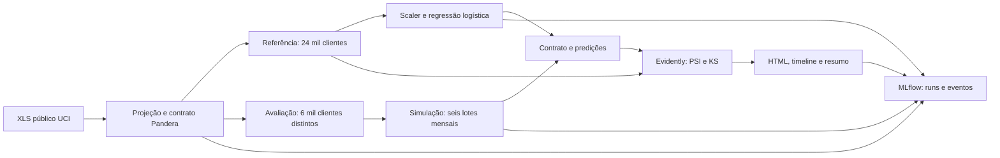
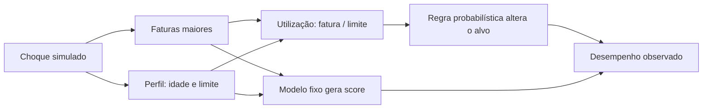

# Tech Challenge · Fase 4

## Etapa 1 · Validação de dados e contratos

O projeto valida lotes de dados de crédito com Pandera e treina uma regressão logística para estimar inadimplência no mês seguinte. O alvo `default_next_month` vale `1` para inadimplência e `0` para os demais casos.

### Base e variáveis

Foi usada a base **Default of Credit Card Clients**, de I-Cheng Yeh, com 30.000 registros de clientes de cartão de crédito em Taiwan. Os valores monetários são em dólares taiwaneses. A base tem licença CC BY 4.0. [UCI Machine Learning Repository · DOI 10.24432/C55S3H](https://doi.org/10.24432/C55S3H)

O modelo usa idade, limite de crédito, status de pagamento, valor faturado e valor pago nos três meses anteriores. O identificador serve para verificar duplicatas e ordenar os dados antes da divisão. Sexo, escolaridade e estado civil foram deixados fora do modelo. A base de origem é histórica e os resultados se aplicam à avaliação acadêmica nesse conjunto.

### Como rodar

Na raiz do repositório, com Python 3.13 e PowerShell:

```powershell
python -m venv .venv
.\.venv\Scripts\python.exe -m pip install -e .
.\.venv\Scripts\python.exe -m credit_scoring train
```

O treino baixa o XLS da UCI para `data/credit_default.xls` se a cópia local ainda não existir. Para usar outro arquivo local, passe `train --input caminho/do/arquivo.xls`. O treino também aceita um CSV com os nomes de coluna do contrato.

O script valida o lote inteiro antes do treino. A divisão estratificada usa 80% dos registros como referência de treinamento e 20% para avaliação separada, com semente 42. A normalização aprende os parâmetros apenas na referência. A regressão logística usa pesos de classe balanceados e as métricas de classificação usam limiar `0.5`.

| Saída | Conteúdo |
| --- | --- |
| `artifacts/baseline.joblib` | Pipeline treinado de normalização e regressão logística. |
| `artifacts/metrics.json` | Métricas da avaliação, incluindo ROC AUC, precisão média, recall e matriz de confusão. |
| `artifacts/reference.csv` | Linhas validadas usadas no treino, disponíveis localmente para a etapa de drift. |

Na execução com a base da UCI, 24.000 registros serviram de referência e 6.000 de avaliação. No conjunto de avaliação, o modelo obteve ROC AUC de **0,7063**, precisão média de **0,4848**, acurácia balanceada de **0,6607** e recall de inadimplência de **62,32%**.

### Contrato de dados

| Campo | Regra |
| --- | --- |
| `customer_id` | Inteiro positivo e único dentro do lote. |
| `age` | Inteiro entre 19 e 120 anos. |
| `credit_limit` | Inteiro positivo. A fonte tem limite de crédito como variável financeira. |
| `payment_status_m1` a `payment_status_m3` | Inteiros entre −2 e 9. `m1` é o mês mais recente. |
| `bill_amount_m1` a `bill_amount_m3` | Inteiros. Valores negativos podem representar saldo credor na fatura. |
| `payment_amount_m1` a `payment_amount_m3` | Inteiros não negativos. |
| `default_next_month` | Inteiro binário. Obrigatório no treino e ausente em lotes para pontuação. |

O contrato rejeita lotes vazios, campos nulos, tipos incompatíveis e colunas ausentes, extras ou duplicadas. No XLS original, a leitura projeta as variáveis escolhidas e usa os nomes do contrato. Para validar um CSV para pontuação, use `validate caminho/do/lote.csv --sem-alvo`.

### Demonstração de bloqueio

O lote de exemplo contém uma idade abaixo do mínimo, um limite de crédito ausente e um identificador repetido. Rode os comandos abaixo para ver a rejeição na validação e na entrada do treino.

```powershell
.\.venv\Scripts\python.exe -m credit_scoring validate examples/lote_invalido.csv
$LASTEXITCODE
.\.venv\Scripts\python.exe -m credit_scoring train --input examples/lote_invalido.csv --output-dir artifacts/lote_invalido
$LASTEXITCODE
Test-Path artifacts/lote_invalido
```

O código `2` indica rejeição pelo contrato. Em uma execução a partir de uma pasta de saída inexistente, `Test-Path` retorna `False`, pois o treino é interrompido antes de gravar qualquer artefato.

## Etapa 2 · Simulação e detecção de drift

A etapa simula seis meses de produção sob um choque econômico, pontua cada lote com o modelo da etapa 1 e compara cada mês com a referência de treino usando o Evidently AI. O objetivo é mostrar quais variáveis mudaram, quando a mudança começou e quanto o modelo perdeu de desempenho.

### Dataset de produção

A produção parte dos 6.000 registros de avaliação da etapa 1, que o modelo não viu no treino. Eles são embaralhados com semente 42 e divididos em seis lotes mensais de 1.000 registros. O choque cresce de forma linear: intensidade 0 no mês 1 e intensidade total no mês 6. O mês 1 sai inalterado e serve de controle para falsos alarmes.

| Fenômeno | Variáveis alteradas | Mudança no mês 6 |
| --- | --- | --- |
| Inflação e maior uso do crédito rotativo | `bill_amount_m1` a `bill_amount_m3` | Faturas nominais 80% maiores. Os pagamentos ficam iguais, pois a renda não acompanha. |
| Novo perfil de clientes | `age` e `credit_limit` | Cada cliente tem 50% de chance de vir do novo perfil, com idade de 19 a 29 anos e limite reduzido à metade, em múltiplos de 10.000. |
| Mudança de conceito | `default_next_month` | Cada adimplente com fatura de pelo menos 70% do limite tem 30% de chance de passar a inadimplir. |

As faturas são a segunda variável mais influente do modelo. Na regressão padronizada, `bill_amount_m1` tem coeficiente −0,32, atrás apenas de `payment_status_m1`, com 0,60. O sinal negativo faz o modelo enxergar menos risco quando a fatura sobe. O status e os valores de pagamento ficam inalterados e servem de controle entre as variáveis.

Todos os lotes passam pelo contrato da etapa 1 antes de serem gravados. O contrato garante tipos e faixas, mas não percebe mudança de distribuição. Essa detecção cabe ao monitoramento de drift. Os parâmetros do cenário ficam em `artifacts/production/cenario.json`.

### Como rodar

Depois do treino da etapa 1, que gera `artifacts/reference.csv`:

```powershell
.\.venv\Scripts\python.exe -m pip install -e .
.\.venv\Scripts\python.exe -m credit_scoring simulate
.\.venv\Scripts\python.exe -m credit_scoring drift
```

O comando `drift` valida todos os lotes de `artifacts/production` antes de pontuar. Um lote que viola o contrato interrompe a execução com código `2`, sem gravar relatório ou predições.

| Saída | Conteúdo |
| --- | --- |
| `reports/drift_report.html` | Relatório Evidently do mês 6: tabela PSI, tabela Kolmogorov-Smirnov e qualidade da classificação contra a referência. |
| `reports/drift_timeline.csv` | PSI, p-valor do KS e severidade por variável e por mês. |
| `reports/drift_summary.json` | Regras usadas e, por mês, desempenho do modelo, variáveis com drift e alerta de desempenho. |
| `artifacts/production/mes_01.csv` a `mes_06.csv` | Lotes de produção, disponíveis localmente. |
| `artifacts/production/predicoes.csv` | Score e classe prevista para cada cliente de cada mês, disponível localmente. |

### Regras de detecção

Cada variável e o score do modelo passam por dois testes do Evidently. O PSI mede o tamanho da mudança, e o teste de Kolmogorov-Smirnov mede se ela é estatisticamente significativa. A variável só é marcada com drift quando os dois concordam: PSI de pelo menos 0,1 e p-valor do KS abaixo de 0,05. O KS sozinho acusa diferenças pequenas em amostras grandes. No mês 6, por exemplo, ele marca o score do modelo com p-valor de 0,0001, embora o PSI seja de apenas 0,05.

| Severidade | Critério |
| --- | --- |
| Estável | PSI abaixo de 0,1 ou p-valor do KS de pelo menos 0,05. |
| Moderado | Drift com PSI de 0,1 até menos de 0,25. |
| Forte | Drift com PSI de 0,25 ou mais. |

O relatório HTML marca drift no lote quando pelo menos 30% das colunas monitoradas mudam, abaixo dos 50% padrão do Evidently. Em crédito, uma mudança dessa proporção já pede revisão do modelo. O alerta de desempenho dispara quando a ROC AUC fica mais de 0,03 abaixo do baseline da etapa 1, que é 0,7063, ou quando o recall de inadimplência fica mais de 10 pontos percentuais abaixo de 62,32%.

### Resultados

| Mês | Variáveis com drift | Inadimplência real | Inadimplência prevista | ROC AUC | Recall | Alerta de desempenho |
| --- | --- | ---: | ---: | ---: | ---: | --- |
| 1 | nenhuma | 21,2% | 37,1% | 0,705 | 61,8% | não |
| 2 | nenhuma | 24,0% | 34,6% | 0,735 | 61,3% | não |
| 3 | `age` | 25,6% | 33,9% | 0,711 | 59,0% | não |
| 4 | `age` e faturas `m1` a `m3` | 28,7% | 33,5% | 0,696 | 53,7% | não |
| 5 | `age` e faturas `m1` a `m3` | 32,5% | 30,5% | 0,655 | 44,6% | sim |
| 6 | `age`, `credit_limit` e faturas `m1` a `m3` | 35,7% | 31,3% | 0,672 | 47,6% | sim |

No mês 6, o relatório do Evidently aponta cinco variáveis degradadas:

| Variável | PSI | p-valor do KS | Severidade |
| --- | ---: | ---: | --- |
| `age` | 0,620 | 7,3 × 10⁻⁹² | forte |
| `bill_amount_m2` | 0,313 | 1,1 × 10⁻²⁸ | forte |
| `bill_amount_m1` | 0,284 | 3,1 × 10⁻²⁶ | forte |
| `bill_amount_m3` | 0,232 | 4,5 × 10⁻²⁸ | moderado |
| `credit_limit` | 0,145 | 7,0 × 10⁻²⁰ | moderado |

As seis variáveis de controle ficam com PSI de no máximo 0,03. O mês 1 não gera nenhum alerta.

A degradação é silenciosa. A inadimplência real sobe de 21,2% para 35,7%, mas a taxa prevista pelo modelo cai de 37,1% para 31,3%, e o score muda pouco (PSI de 0,05). Quem monitorasse só as predições não veria o problema. O drift das variáveis aparece no mês 3, dois meses antes de os rótulos confirmarem a queda de desempenho. No mês 6, o modelo deixa passar 187 dos 357 inadimplentes.

As métricas de referência exibidas no HTML são calculadas sobre os dados de treino e por isso são mais otimistas, com ROC AUC de 0,726. A comparação oficial usa o baseline medido na avaliação separada da etapa 1.

## Etapa 3 · Observabilidade do pipeline e do modelo

O **MLflow** centraliza cada execução de `validate`, `train`, `simulate` e `drift`, seus eventos JSONL, métricas e artefatos. Foi escolhida a alternativa de rastreamento permitida no enunciado: um serviço com SQLite e armazenamento persistente, sem adicionar uma stack de dashboards. O `psutil` amostra recursos durante a execução. Não há mudança no classificador nem nos limiares de drift.

### Deploy completo atualizado — etapas 1, 2 e 3

Pré-requisitos: Docker Desktop iniciado com containers Linux, Docker Compose disponível, porta 5000 livre e acesso à internet para baixar a imagem/dependências e a base pública da UCI na primeira execução. Não é necessário instalar Python ou criar `.venv` no computador para esse deploy.

Abra o PowerShell na raiz da cópia do projeto, na pasta que contém `compose.yaml`. Todos os caminhos locais são relativos a essa pasta. Execute o bloco abaixo; as verificações interrompem a sequência se alguma etapa falhar:

```powershell
docker compose up -d --build --wait mlflow
if ($LASTEXITCODE -ne 0) { throw "Falha ao iniciar o MLflow." }

docker compose run --rm pipeline train
if ($LASTEXITCODE -ne 0) { throw "Falha no treinamento." }

docker compose run --rm pipeline simulate
if ($LASTEXITCODE -ne 0) { throw "Falha na simulacao." }

docker compose run --rm pipeline drift
if ($LASTEXITCODE -ne 0) { throw "Falha na analise de drift." }
```

| Comando | Resultado esperado |
| --- | --- |
| `up ... mlflow` | Constrói a imagem compartilhada e inicia o servidor; aguarda o healthcheck. |
| `train` | Baixa a base se necessário, valida 30.000 registros, treina com 24.000 e avalia com 6.000. Grava modelo, referência e métricas. |
| `simulate` | Divide os 6.000 registros de avaliação em seis lotes de 1.000 e aplica um choque crescente. São períodos simulados, não meses reais de produção. |
| `drift` | Compara cada lote com a referência, gera predições/relatórios e registra métricas e alertas no MLflow. O HTML apresenta o mês 6. |

Todos esses comandos devem terminar com código **0**, mesmo quando a análise identifica drift. O servidor permanece ativo; os containers dos jobs terminam após cada comando. Não há agendamento automático: cada nova análise exige executar o comando correspondente.

Para completar a demonstração do contrato, execute também o lote propositalmente inválido:

```powershell
docker compose run --rm pipeline validate /app/examples/lote_invalido.csv
if ($LASTEXITCODE -ne 2) { throw "A demonstracao deveria rejeitar o lote com codigo 2." }
```

Esse último comando deve retornar **2**, demonstrando a rejeição. Ele não é necessário para gerar o relatório de drift e não desfaz os resultados anteriores. No MLflow, sua run aparece como `FAILED`, com `pipeline.outcome=rejected`: é o resultado esperado desse teste.

Abra **http://localhost:5000**, entre no experimento **credit-scoring** e compare as execuções `train`, `simulate`, `drift` e `validate`. Na run `drift`, a aba **Artifacts** permite baixar `drift_report.html`, `drift_summary.json` e `drift_timeline.csv`. Os arquivos gerados pelo Docker ficam nos volumes; a pasta `reports/` do checkout não é atualizada automaticamente.

Para conferir a disponibilidade ou investigar uma falha de inicialização:

```powershell
docker compose ps
docker compose logs --tail 100 mlflow
```

O serviço só publica a porta no endereço local. Esse é o deploy local completo da entrega acadêmica. Para uso remoto, mantenha-o em rede privada ou atrás de proxy com autenticação e TLS, configurando os hosts permitidos.

A imagem roda com usuário sem privilégios e reaproveita a camada de dependências nos próximos builds. O volume `tracking` mantém SQLite e artefatos; `pipeline` mantém dados, modelo, produção e logs. O download da UCI ocorre apenas na primeira execução. `docker compose down` para o serviço sem apagar esses volumes; não use `down -v` se quiser preservar o histórico. O healthcheck consulta `/health` antes de liberar os comandos do pipeline. SQLite atende a esta demonstração com execuções sequenciais; múltiplos workers de produção pedem banco e armazenamento compartilhados.

Para parar e depois voltar a consultar as execuções existentes, sem repetir o treino:

```powershell
docker compose down
docker compose up -d --wait mlflow
```

Se apenas quiser repetir o diagnóstico com modelo e lotes já gerados, rode `docker compose run --rm pipeline drift`. Para reproduzir tudo, repita `train`, `simulate` e `drift`, nessa ordem. Cada comando cria uma nova run no MLflow; os arquivos de trabalho nos volumes são substituídos, mas os artefatos das runs anteriores permanecem no histórico. Após alterar o código ou as dependências, execute novamente `docker compose up -d --build --wait mlflow` antes dos jobs.

### Execução local sem Docker

Os comandos das etapas anteriores passam a registrar execuções automaticamente, mesmo sem servidor aberto. Depois de instalar o pacote com `pip install -e .`, rode `train`, `simulate`, `drift` e a validação inválida conforme as seções anteriores. Para consultar o histórico:

```powershell
.\.venv\Scripts\mlflow.exe server --backend-store-uri sqlite:///monitoring/mlflow.db --host 127.0.0.1 --port 5000 --workers 1
```

Por padrão, o banco, artefatos e logs ficam em `monitoring/`, ignorado pelo Git. `CREDIT_MONITORING_DIR` muda esse diretório; `MLFLOW_TRACKING_URI` permite enviar as execuções a um servidor. Os históricos local e Docker são independentes. Não execute dois servidores na mesma porta. Uma indisponibilidade do tracking interrompe o comando e deve ser tratada como falha operacional; não se declara sucesso sem registrar a execução.

### O que observar no MLflow

1. Na lista de runs, veja `pipeline.command`, `pipeline.outcome`, status e duração. Rejeições e exceções encerram a run como `FAILED`; `pipeline.outcome` distingue `rejected` de `failed`.
2. Abra uma run `drift` e selecione as métricas `model/roc_auc`, `model/default_recall`, `alerts/drift` e `alerts/performance`. Use **Step** no eixo X: passos 1 a 6 correspondem aos meses simulados, não a meses reais de execução.
3. Em **Artifacts**, consulte `drift_summary.json`, `drift_timeline.csv`, `drift_report.html` e o log `.jsonl`. O HTML pode ser baixado e aberto no navegador. PSI, KS e severidade por variável estão na tabela e no relatório.
4. Abra a validação inválida e confira `alerts/contract=1`, `stage/ingestion/success=0` e os eventos `stage_failed` e `run_finished`. Os logs usam UTC e incluem `run_id` para correlação.
5. Nas métricas `infra/*`, acompanhe memória, CPU acumulada e espaço disponível durante cada comando. A run de treino também guarda métricas, modelo e hashes SHA-256; a run de drift registra o hash do modelo, da referência e de cada lote para correlacionar entradas e resultados.

| Métrica | Unidade e interpretação |
| --- | --- |
| `pipeline/success` | 1 se concluiu; 0 se falhou ou foi rejeitado. |
| `pipeline/duration_seconds` | Tempo total observado da execução, incluindo registro das métricas. |
| `stage/<nome>/success`, `stage/<nome>/duration_seconds` | Status e latência de ingestão, treinamento, transformação ou análise de drift. |
| `pipeline/input_rows` | Linhas recebidas por treino/simulação após validação. |
| `pipeline/rows` | Linhas validadas no `validate`/`train`, geradas no `simulate` ou analisadas no `drift`; exclui a referência no drift. Ausente se o comando não chegou a concluir essa contagem. |
| `pipeline/batches` | Quantidade de lotes gerados pela simulação. |
| `alerts/failure`, `alerts/contract` | Indicadores 0/1 de falha e rejeição pelo contrato por execução; some runs para contar ocorrências. |
| `alerts/drift` | 1 por mês quando qualquer feature ou score satisfaz PSI ≥ 0,1 **e** KS < 0,05. |
| `alerts/performance` | 1 por mês quando AUC cai mais de 0,03 ou recall cai mais de 0,10 contra o baseline separado. |
| `pipeline/alerts` | Soma dos alertas mensais de drift e desempenho; um mês pode contribuir com dois. |
| `drift/features` | Número de features com drift por mês; não inclui o score. |
| `model/*`, `batch/rows` | AUC, recall, taxas real/prevista e volume mensal. |
| `infra/process_rss_mb` | Memória residente do processo, em MiB. |
| `infra/peak_sampled_rss_mb` | Maior RSS amostrado; picos entre amostras podem não ser capturados. |
| `infra/process_cpu_seconds` | CPU acumulada do processo (usuário + sistema), em segundos; não é percentual. |
| `infra/host_memory_percent` | Uso de memória do host visto pelo sistema operacional. Em Docker pode representar a VM, não o limite do container. |
| `infra/disk_free_gb` | Espaço livre no filesystem do monitoramento, em GiB. |

Recursos são amostrados no início, aproximadamente a cada segundo e no fim; o eixo Step dessas métricas é o índice da amostra. O monitoramento cobre a infraestrutura **durante os jobs**, não é um agente de host contínuo. O healthcheck cobre a disponibilidade HTTP do servidor enquanto ele está ativo. Alertas são registrados e visualizados, sem envio de e-mail nem retreino automático. Um alerta de modelo não muda o status da execução para falha: o diagnóstico foi concluído com sucesso.

Logs não armazenam linhas de clientes nem mensagens completas de exceção; guardam tipo de erro, etapa, resultado e agregados. CSVs de referência e predições não são enviados ao MLflow. O HTML do Evidently contém estatísticas/distribuições e deve ter o mesmo controle de acesso dos demais artefatos. A política completa de governança permanece na etapa 4.

### Verificação

```powershell
.\.venv\Scripts\python.exe -m unittest discover -s tests -v
.\.venv\Scripts\python.exe -m pip check
```

Os testes cobrem regras do contrato, bloqueio antes da gravação, separação reproduzível entre referência e produção, mês de controle sem alteração, validação de todos os lotes e persistência real no MLflow de sucesso, rejeição e falha inesperada. A revisão também adicionou duas proteções ao monitor: rejeitar sobreposição de clientes entre referência e produção e impedir que uma ROC AUC indefinida em lote com uma só classe seja apresentada como saudável.

Validação em 15/11/2026: **7 testes passaram**, `pip check` não apontou incompatibilidades e o fluxo Docker completo reproduziu AUC **0,706286**, seis lotes de 1.000 registros, drift a partir do mês 3 e alertas de desempenho nos meses 5 e 6. A consulta à API confirmou logs e artefatos persistidos, seis pontos mensais por métrica de modelo e seis alertas (quatro de drift + dois de desempenho). O serviço passou no healthcheck após recriação, preservando o histórico. Evidências agregadas desta execução: [`reports/observability_validation.json`](reports/observability_validation.json).

Referências técnicas: [MLflow Tracking](https://mlflow.org/docs/latest/tracking), [armazenamento e servidor](https://mlflow.org/docs/latest/self-hosting) e [métricas psutil](https://psutil.readthedocs.io/stable/).

## Etapa 4 · Governança, privacidade e causalidade

Esta seção atende às tarefas teóricas da etapa 4 do enunciado. O projeto é uma demonstração acadêmica com dados históricos públicos; não concede crédito nem decide sobre pessoas em produção. Os controles abaixo distinguem o que o código já faz das políticas propostas para uma fintech. A documentação não representa certificação de conformidade.

### Arquitetura e rastreabilidade



O contrato bloqueia entradas inválidas antes da gravação dos resultados. O monitor rejeita clientes compartilhados entre referência e produção. MLflow associa eventos, métricas e artefatos por `run_id`; hashes identificam o modelo e as entradas usadas. Isso permite investigar uma execução, mas hashes não anonimizam dados nem constituem assinatura de auditoria inviolável. O código e as dependências estão no Git; numa operação real, registrar também o commit e o digest da imagem em cada aprovação de modelo.

### Inventário, minimização e Privacy by Default

| Informação | Tratamento implementado | Risco e política proposta |
| --- | --- | --- |
| XLS original (`data/`) | Cópia local da fonte pública, fora do Git. Contém também campos descartados na seleção. | A seleção não apaga os campos da cópia original. Restringir acesso e aplicar a retenção abaixo. |
| `customer_id` | Identificador da fonte mantido para unicidade, divisão e predições; excluído das features. | Não é anonimização comprovada. Em produção, substituir por token e guardar a correspondência em cofre separado. |
| Idade, limite, faturas, pagamentos e alvo | Apenas as variáveis necessárias à demonstração entram no pipeline; sexo, escolaridade e estado civil não entram no modelo. | Dados financeiros e combinações de atributos podem permitir associação a indivíduos. Não publicar linhas nem tentar reidentificação. |
| Referência, lotes e predições | Permanecem em arquivos locais ou no volume `pipeline`, fora do Git e sem upload como CSV ao MLflow. | São dados individuais, inclusive scores: acesso restrito a engenharia e ciência de dados autorizadas. |
| Logs JSONL | Tipo de erro, etapa, resultado e agregados; sem linhas de clientes ou mensagem completa de exceção. | Revisar saídas de terminal antes de gravar o vídeo; o terminal de validação pode exibir valores inválidos. |
| HTML, métricas e modelo | Relatórios agregados e modelo ficam no repositório e/ou no tracking. | Agregação não garante anonimato, sobretudo com grupos pequenos. Publicação acadêmica limitada à base pública; não replicar essa prática com clientes reais. |

PII significa informação pessoal identificável; não é sinônimo da categoria legal de dado pessoal sensível. Dados financeiros exigem proteção, mas não são automaticamente dados sensíveis do art. 5º, II. Não há uso intencional de saúde, biometria, religião ou origem racial. A ausência de nome e CPF e a licença pública não comprovam anonimização. A simulação altera registros históricos, portanto seus lotes não são uma base integralmente sintética sem vínculo com a origem.

Já implementado: minimização das features, exclusão dos arquivos individuais pelo `.gitignore`, logs reduzidos, containers sem privilégios e publicação do MLflow apenas em `127.0.0.1`. O `.gitignore` não controla acesso nem remove cópias já distribuídas. Não há autenticação de usuários no MLflow local, criptografia própria, expurgo automático ou controle de acesso por perfil implementado.

Para produção, a política proposta exige autenticação com MFA, permissões por função, TLS, criptografia de discos e backups com chaves gerenciadas, segredos fora do Git, revisão de acessos trimestral e registro de acesso/exportação. Relatórios e modelos recebem a mesma restrição das evidências de crédito. O acesso externo permanece fechado até esses controles serem verificados.

### Finalidade, base legal e direitos

A finalidade acadêmica é avaliar a confiabilidade do pipeline, respeitando a licença CC BY 4.0 e a atribuição à UCI. Não se presume que licença de uso substitua base legal para tratar dados pessoais. Para a fintech hipotética, a base proposta para avaliação de risco é **proteção do crédito (art. 7º, X)**, sujeita à análise do tratamento concreto pelo controlador; ela não autoriza reutilização irrestrita ou tratamento de dados sensíveis. A finalidade e a necessidade de cada campo devem constar do inventário de tratamento.

O plano prevê aviso de privacidade, canal do encarregado, verificação de identidade com dados mínimos, registro das solicitações e atendimento dos direitos aplicáveis. Para decisões exclusivamente automatizadas, prevê pedido de revisão e informação clara sobre critérios e procedimentos, preservados os segredos comercial e industrial. A revisão humana é uma escolha de governança deste plano. Referência: [LGPD, arts. 5º, 7º, 18 e 20 — texto atualizado na Câmara](https://www2.camara.leg.br/legin/fed/lei/2018/lei-13709-14-agosto-2018-787077-normaatualizada-pl.html).

### Retenção e descarte

Os prazos abaixo são **propostas internas para a demonstração**, não prazos legais universais e não estão automatizados. O responsável pela entrega registra a data de encerramento da avaliação e executa a revisão de descarte. Em produção, jurídico e encarregado aprovam uma matriz por finalidade, obrigações aplicáveis e eventuais bloqueios de eliminação antes da ingestão de clientes reais.

| Classe | Prazo proposto e marco inicial | Destinação |
| --- | --- | --- |
| XLS, referência, lotes e predições individuais | Até 30 dias após o encerramento da avaliação acadêmica. | Excluir cópias locais, exportações e dados correspondentes nos volumes, após inventário e confirmação de que não há obrigação de preservação. |
| Logs, banco MLflow, modelos e relatórios privados | Até 90 dias após o encerramento da avaliação. | Preservar apenas evidência agregada necessária; expurgar runs, artefatos e cópias correlatas de forma coordenada. |
| Backups que venham a ser criados | Expiração em até 30 dias após exclusão na origem. | Restringir restauração e reaplicar exclusões após recuperação. Backups não são criados pelo projeto. |
| Código, README e relatórios acadêmicos já publicados | Revisão anual a partir da entrega, condicionada à finalidade educacional e à ausência de dados identificáveis. | Remover conteúdo inadequado; se houver exposição individual, tratar também histórico Git e cópias conhecidas. Não prometer revogação de clones públicos. |

Registrar no comprovante de descarte: classe de informação, local, data, responsável e resultado, sem reproduzir dados individuais. Apagar somente arquivos de trabalho não elimina artefatos das runs nem volumes Docker. O procedimento exige inventário; `docker compose down -v` não deve ser usado como expurgo seletivo. Exceções de retenção precisam de justificativa, acesso limitado e data de revisão.

### Responsabilidades e incidentes

Na demonstração, a equipe do projeto assume a manutenção da documentação e a revisão de artefatos. Para produção, os papéis propostos são: controlador/gestão de crédito aprova finalidade e uso; engenharia responde por contratos e operação; ciência de dados investiga drift e desempenho; segurança responde por acesso e incidentes; encarregado/jurídico responde por privacidade, retenção e solicitações. São responsabilidades propostas, sem pessoas ou canais operacionais fictícios atribuídos.

Em suspeita de vazamento: restringir o acesso afetado, preservar evidências sem copiar dados desnecessários, acionar segurança e encarregado, avaliar titulares e impacto, corrigir a causa e registrar as medidas. Quando houver risco ou dano relevante, o controlador deve observar a comunicação à ANPD e aos titulares, em regra em três dias úteis do conhecimento de que o incidente afetou dados pessoais, ressalvadas regras específicas aplicáveis. Referência: [ANPD — Comunicação de Incidente de Segurança](https://www.gov.br/anpd/pt-br/canais_atendimento/agente-de-tratamento/comunicado-de-incidente-de-seguranca-cis). Um alerta de drift, isoladamente, não é evidência de incidente de privacidade.

### Causalidade: mecanismo simulado e limites da evidência

A hipótese do cenário é que o aumento das faturas sem crescimento dos pagamentos e a entrada de clientes com limites menores elevem o comprometimento do crédito. A implementação aumenta faturas em até 80%, altera probabilisticamente idade e limite e converte parte dos adimplentes com utilização de pelo menos 70% em inadimplentes. Não há variável de renda ou inflação observada; esses nomes descrevem o cenário construído.



O diagrama descreve as regras do gerador, não um efeito causal identificado na economia real. A mudança das entradas caracteriza data drift; a regra adicional de inadimplência introduz mudança de conceito no cenário. PSI e KS medem mudança de distribuição, não demonstram sozinhos concept drift nem causalidade. A queda de desempenho com rótulos disponíveis complementa o diagnóstico; em produção, ela só poderá ser medida após maturação do alvo.

As evidências em [`drift_summary.json`](reports/drift_summary.json) e [`drift_timeline.csv`](reports/drift_timeline.csv) mostram: mês 1 sem alerta, primeiro drift no mês 3 e alerta de desempenho nos meses 5 e 6. No mês 6, cinco features mudam; a AUC cai de 0,7063 no baseline separado para 0,6724 e o recall de 62,32% para 47,62%. Dos 357 inadimplentes, 187 não são detectados. Isso indica risco de crédito não capturado, mas não permite estimar prejuízo financeiro sem exposição e perda por cliente.

O coeficiente negativo da fatura ajuda a explicar por que seu aumento pode reduzir o score, mantidas as demais features, mas não prova que faturas maiores causem menor risco real. As intervenções são simultâneas e cada mês usa clientes distintos; portanto a série não isola o efeito de cada mudança. O controle do mês 1 e as features de pagamento inalteradas ajudam a interpretar a simulação, sem eliminar essa limitação.

Para investigar a contribuição de cada mecanismo, o plano é comparar, sobre os mesmos clientes e sorteios controlados, quatro cenários: sem choque, apenas faturas, apenas perfil e apenas alteração do alvo, além do cenário combinado. Comparar métricas com intervalos de incerteza e repetir sementes antes de atribuir efeitos. Essa ablação é proposta e **não foi executada nesta entrega**. Em dados reais, também seria necessário investigar mudanças de seleção, política de concessão, captura de dados e maturação de rótulos.

### Prescrição, mitigação de vieses e aprovação

| Gatilho implementado | Resposta operacional proposta | Responsável proposto |
| --- | --- | --- |
| Contrato rejeitado, código 2 | Quarentenar lote, corrigir origem e revalidar; não relaxar regras para aceitar o erro. O bloqueio já é automático, a quarentena operacional é proposta. | Engenharia |
| Drift: PSI ≥ 0,1 e KS < 0,05 | Investigar origem/perfil, verificar contrato e acompanhar segmentos; não retreinar somente por p-valor. | Ciência de dados |
| AUC < baseline − 0,03 ou recall < baseline − 0,10 | Priorizar investigação e propor revisão manual das decisões afetadas; avaliar suspensão do uso automático conforme impacto. | Ciência de dados e gestão de crédito |
| Falha de execução ou tracking | Corrigir indisponibilidade, preservar evidências e repetir o job; ausência de métrica não significa modelo saudável. | Engenharia |

O MLflow registra os alertas, mas não envia notificações, não suspende decisões e não retreina automaticamente. O cenário atual já satisfaz o gatilho de investigação de desempenho nos meses 5 e 6.

Excluir sexo, escolaridade e estado civil não garante ausência de discriminação: idade e limite podem atuar como proxies. Antes de uso real, o plano é medir recall, falsos positivos, calibração e taxa de aprovação por faixas etárias e outros grupos cuja avaliação tenha finalidade e base jurídica definidas, com tamanho mínimo de amostra e incerteza. Falsos negativos aumentam risco de inadimplência; falsos positivos podem negar crédito indevidamente. Diferenças materiais devem ser investigadas e revisadas pela gestão de risco, sem publicar células pequenas. **Essa auditoria de equidade ainda não foi implementada**, e a base histórica de Taiwan não valida uso em clientes brasileiros.

Um candidato a retreino só seria promovido após avaliação em janela independente com rótulos maduros, comparação com o modelo atual, revisão de vieses e aprovação registrada. Como critérios técnicos iniciais propostos, exigir AUC e recall dentro das tolerâncias do baseline, análise de custos de erro e ausência de disparidades sem justificativa aceitável. Guardar versão anterior para rollback; rollback só resolve se a versão anterior for validada para o cenário atual. Ajuste de limiar, novas features ou recalibração exigem nova avaliação, não aprovação automática.

### Vídeo STAR

**Link do vídeo:** [Apresentação STAR — Tech Challenge Fase 4](https://drive.google.com/file/d/1RMpl4p0oJzk2ydMrEyQ2PLxd9WMVJj5F/view?usp=sharing)
